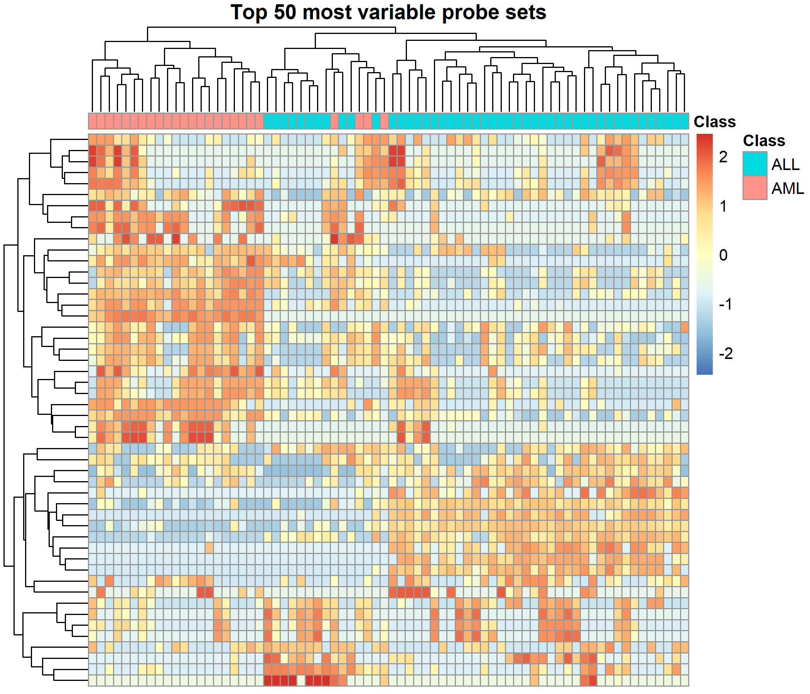

```{r setup, include=FALSE}
knitr::opts_chunk$set(echo = TRUE, warning = FALSE, message = FALSE,
                      fig.width = 7, fig.height = 5, dpi = 150)
set.seed(2026)                      # reproducibility
dir.create("../figures", showWarnings = FALSE)
dir.create("../results", showWarnings = FALSE)
```

# 0. Packages


# Install missing CRAN / Bioconductor packages (first run only)

```{r packages}
options(repos = c(CRAN = "https://cloud.r-project.org"))

cran <- c("tidyverse", "pheatmap", "e1071", "caret", "BiocManager", "readr")

bioc <- c("limma", "hu6800.db",
          "AnnotationDbi", "clusterProfiler", "org.Hs.eg.db",
          "enrichplot")

for (p in cran) {
  if (!requireNamespace(p, quietly = TRUE)) {
    install.packages(p, repos = "https://cloud.r-project.org")
  }
}

if (!requireNamespace("BiocManager", quietly = TRUE)) {
  install.packages("BiocManager",
                   repos = "https://cloud.r-project.org")
}

for (p in bioc) {
  if (!requireNamespace(p, quietly = TRUE)) {
    BiocManager::install(p, ask = FALSE, update = FALSE)
  }
}

suppressPackageStartupMessages({
  library(tidyverse)
  library(pheatmap)
  library(e1071)
  library(caret)
  library(limma)
  library(AnnotationDbi)
  library(hu6800.db)
  library(clusterProfiler)
  library(org.Hs.eg.db)
  library(enrichplot)
})
```

# 1. Data import

The Golub et al. (1999) dataset: bone-marrow samples from patients with acute
lymphoblastic leukaemia (ALL) or acute myeloid leukaemia (AML), profiled on
Affymetrix Hu6800 arrays (7,129 probe sets). The original **training set**
(38 samples) and independent **test set** (34 samples) are kept separate so
that a genuine hold-out validation is possible.

```{r import}
# Read the downloaded Golub CSV stored in the project's data folder.
# The CSV has 6 sample-metadata columns followed by 7,129 probe columns.
data_file <- file.path("..", "data", "golub.csv")
if (!file.exists(data_file)) {
  stop("Cannot find data/golub.csv. Place the downloaded file in the project's data folder.")
}

golub_df <- readr::read_csv(data_file, show_col_types = FALSE)

required_meta <- c("Samples", "BM.PB", "Gender", "Source", "tissue.mf", "cancer")
missing_meta <- setdiff(required_meta, names(golub_df))
if (length(missing_meta) > 0) {
  stop("The downloaded CSV is missing required columns: ",
       paste(missing_meta, collapse = ", "))
}

# Original Golub sample IDs 1-38 are training samples; 39-72 are test samples.
# allB and allT are both ALL subtypes; aml is AML.
golub_df <- golub_df %>%
  mutate(
    sample_id = as.integer(Samples),
    split = if_else(sample_id <= 38, "train", "test"),
    class = if_else(tolower(cancer) == "aml", "AML", "ALL")
  ) %>%
  arrange(factor(split, levels = c("train", "test")), sample_id)

probe_cols <- setdiff(names(golub_df), c(required_meta, "sample_id", "split", "class"))
expr_raw <- t(as.matrix(golub_df[, probe_cols]))
storage.mode(expr_raw) <- "numeric"

meta <- golub_df %>%
  transmute(
    sample = paste0("sample_", sample_id),
    split = factor(split, levels = c("train", "test")),
    class = factor(class, levels = c("ALL", "AML")),
    cell = tissue.mf,
    source = BM.PB,
    gender = Gender
  )

colnames(expr_raw) <- meta$sample
rownames(expr_raw) <- probe_cols

stopifnot(ncol(expr_raw) == nrow(meta))
stopifnot(nrow(expr_raw) == 7129)
stopifnot(sum(meta$split == "train") == 38)
stopifnot(sum(meta$split == "test") == 34)

dim(expr_raw)
table(meta$split, meta$class)
```

# 2. Quality control

```{r qc}
cat("Missing values:", sum(is.na(expr_raw)), "\n")
cat("Value range   :", range(expr_raw), "\n")
cat("Probes with negative values:", sum(rowSums(expr_raw < 0) > 0), "\n")

# Class balance
meta %>% count(class, split) %>%
  ggplot(aes(split, n, fill = class)) + geom_col(position = "dodge") +
  labs(title = "Class balance", x = NULL, y = "Samples") + theme_minimal()
ggsave("../figures/01_class_balance.png", width = 6, height = 4)

# Raw intensity distribution (skewed -> log transform needed)
long_raw <- as.data.frame(expr_raw) %>% pivot_longer(everything(), names_to = "sample", values_to = "value")
ggplot(long_raw, aes(sample, value)) + geom_boxplot(outlier.size = .2) +
  theme_minimal() + theme(axis.text.x = element_blank()) +
  labs(title = "Raw intensities per sample", y = "Intensity")
ggsave("../figures/02_raw_boxplot.png", width = 8, height = 4)
```

# 3. Pre-processing

Following Dudoit et al. (2002): (i) floor at 100 and ceiling at 16,000,
(ii) remove probes with max/min <= 5 or (max - min) <= 500 (uninformative),
(iii) log2-transform. These steps are *unsupervised* (they do not use class
labels), so applying them to all samples does not leak label information.

```{r preprocess}
x <- pmin(pmax(expr_raw, 100), 16000)
mx <- apply(x, 1, max); mn <- apply(x, 1, min)
keep <- (mx / mn > 5) & (mx - mn > 500)
expr <- log2(x[keep, ])
cat("Probes before:", nrow(expr_raw), " after filtering:", nrow(expr), "\n")

long_p <- as.data.frame(expr) %>% pivot_longer(everything(), names_to = "sample", values_to = "value")
ggplot(long_p, aes(sample, value)) + geom_boxplot(outlier.size = .2) +
  theme_minimal() + theme(axis.text.x = element_blank()) +
  labs(title = "Pre-processed (log2) intensities per sample", y = "log2 intensity")
ggsave("../figures/03_processed_boxplot.png", width = 8, height = 4)
```

# 4. Exploratory data analysis

## 4.1 Principal component analysis

```{r pca}
pca <- prcomp(t(expr), scale. = TRUE)
var_exp <- round(100 * pca$sdev^2 / sum(pca$sdev^2), 1)
pc_df <- data.frame(pca$x[, 1:3], meta)

ggplot(pc_df, aes(PC1, PC2, colour = class, shape = split)) +
  geom_point(size = 3) + theme_minimal() +
  labs(title = "PCA of leukaemia samples",
       x = paste0("PC1 (", var_exp[1], "%)"), y = paste0("PC2 (", var_exp[2], "%)"))
ggsave("../figures/04_pca.png", width = 7, height = 5)
```

## 4.2 Heatmap of the 50 most variable genes

```{r heatmap}
top_var <- names(sort(apply(expr, 1, var), decreasing = TRUE))[1:50]
ann <- data.frame(Class = meta$class, row.names = meta$sample)
pheatmap(expr[top_var, ], scale = "row", annotation_col = ann,
         show_colnames = FALSE, show_rownames = FALSE,
         main = "Top 50 most variable probe sets",
         filename = "../figures/05_heatmap_top_var.png", width = 7, height = 6)
```



## 4.3 Unsupervised clustering

```{r clust}
hc <- hclust(dist(t(expr)), method = "ward.D2")
cl <- cutree(hc, k = 2)
print(table(Cluster = cl, Class = meta$class))
```

# 5. Differential expression (limma)

```{r de}
design <- model.matrix(~ 0 + class, data = meta)
colnames(design) <- levels(meta$class)
fit <- lmFit(expr, design)
fit <- eBayes(contrasts.fit(fit, makeContrasts(AML - ALL, levels = design)))
tt <- topTable(fit, number = Inf, adjust.method = "BH") %>% rownames_to_column("probe")

# Gene-symbol annotation (falls back to probe ID if unavailable)
tt$symbol <- tryCatch(
  AnnotationDbi::mapIds(hu6800.db::hu6800.db, keys = tt$probe, column = "SYMBOL",
                        keytype = "PROBEID", multiVals = "first"),
  error = function(e) tt$probe)
tt$symbol[is.na(tt$symbol)] <- tt$probe[is.na(tt$symbol)]

tt <- tt %>% mutate(sig = adj.P.Val < 0.01 & abs(logFC) > 1)
cat("Significant probes (FDR<0.01, |log2FC|>1):", sum(tt$sig), "\n")
results_dir <- "../results"
dir.create(results_dir, showWarnings = FALSE, recursive = TRUE)
de_file <- file.path(results_dir, "differential_expression.csv")
tryCatch(
  readr::write_csv(tt, de_file),
  error = function(e) {
    # If Windows has the original CSV open in Excel, save a second copy instead.
    fallback_file <- file.path(results_dir, "differential_expression_new.csv")
    readr::write_csv(tt, fallback_file)
    message("Could not overwrite differential_expression.csv (it may be open). ",
            "Saved results to ", fallback_file)
  }
)
knitr::kable(head(tt[, c("symbol", "logFC", "AveExpr", "adj.P.Val")], 15), digits = 3)

ggplot(tt, aes(logFC, -log10(adj.P.Val), colour = sig)) +
  geom_point(alpha = .5, size = 1) +
  geom_text(data = head(tt, 10), aes(label = symbol), colour = "black", size = 3, vjust = -0.6) +
  scale_colour_manual(values = c("grey60", "firebrick")) +
  theme_minimal() + labs(title = "Volcano plot: AML vs ALL", x = "log2 fold change", y = "-log10 adjusted p")
ggsave("../figures/06_volcano.png", width = 7, height = 5)
```

# 6. Functional enrichment (optional)

```{r go}
go_res <- tryCatch({
  is_sym <- !grepl("_at$|^AFFX", tt$symbol)
  genes <- unique(tt$symbol[tt$sig & is_sym])
  universe <- unique(tt$symbol[is_sym])
  clusterProfiler::enrichGO(genes, OrgDb = "org.Hs.eg.db", keyType = "SYMBOL",
                            ont = "BP", universe = universe,
                            pAdjustMethod = "BH", qvalueCutoff = 0.05)
}, error = function(e) { message("GO skipped: ", e$message); NULL })

if (!is.null(go_res) && nrow(as.data.frame(go_res)) > 0) {
  print(enrichplot::dotplot(go_res, showCategory = 12))
  ggsave("../figures/07_go_enrichment.png", width = 8, height = 6)
  write_csv(as.data.frame(go_res), "../results/go_enrichment.csv")
}
```

# 7. Classification (SVM)

## 7.1 Cross-validation with feature selection **inside** each fold

Selecting genes on all data and then cross-validating gives over-optimistic
accuracy (selection bias). Here the top-*k* genes (limma) are chosen using the
training portion of each fold only. Repeated stratified 5-fold CV is used.

```{r cv}
select_genes <- function(mat, y, k) {
  d <- model.matrix(~ 0 + y)
  colnames(d) <- levels(y)
  f <- eBayes(contrasts.fit(lmFit(mat, d),
                           makeContrasts(AML - ALL, levels = d)))
  rownames(topTable(f, number = min(k, nrow(mat)), sort.by = "P"))
}

fit_predict <- function(tr, te, y_tr, k) {
  g <- select_genes(expr[, tr, drop = FALSE], y_tr, k)
  m <- svm(t(expr[g, tr, drop = FALSE]), y_tr,
           kernel = "linear", cost = 1, scale = TRUE)
  predict(m, t(expr[g, te, drop = FALSE]))
}

# Cross-validation is performed only on the 38 original training samples.
# The 34 original test samples remain untouched until the final evaluation.
y <- meta$class
train_idx <- which(meta$split == "train")
y_train <- droplevels(y[train_idx])

cv_res <- map_dfr(c(5, 10, 25, 50, 100), function(k) {
  folds <- createMultiFolds(y_train, k = 5, times = 5)
  acc <- map_dbl(folds, function(tr_local) {
    te_local <- setdiff(seq_along(y_train), tr_local)
    tr <- train_idx[tr_local]
    te <- train_idx[te_local]
    pred_fold <- fit_predict(tr, te, droplevels(y[tr]), k)
    mean(pred_fold == y[te])
  })
  tibble(k = k, mean_acc = mean(acc), sd_acc = sd(acc))
})
knitr::kable(cv_res, digits = 3)

ggplot(cv_res, aes(k, mean_acc)) +
  geom_line() + geom_point() +
  geom_errorbar(aes(ymin = mean_acc - sd_acc,
                    ymax = mean_acc + sd_acc), width = 3) +
  scale_x_continuous(breaks = cv_res$k) + theme_minimal() +
  labs(title = "Repeated 5-fold CV accuracy (training samples only)",
       x = "Genes selected (k)", y = "Accuracy")
ggsave("../figures/08_cv_accuracy.png", width = 6, height = 4)
```

## 7.2 Independent hold-out validation

Train on the original 38 training samples, test on the untouched 34-sample test set.

```{r holdout}
k_best <- cv_res$k[which.max(cv_res$mean_acc)]
tr <- which(meta$split == "train"); te <- which(meta$split == "test")
pred <- fit_predict(tr, te, droplevels(y[tr]), k_best)
cm <- confusionMatrix(pred, y[te], positive = "AML")
cm
write_csv(as.data.frame(cm$table), "../results/confusion_matrix.csv")
```

```{r cm_plot}
as.data.frame(cm$table) %>%
  ggplot(aes(Reference, Prediction, fill = Freq)) + geom_tile() +
  geom_text(aes(label = Freq), size = 6) +
  scale_fill_gradient(low = "white", high = "steelblue") + theme_minimal() +
  labs(title = paste0("Hold-out confusion matrix (k = ", k_best, " genes)"))
ggsave("../figures/09_confusion_matrix.png", width = 5, height = 4)
```

# 8. Session information

```{r session}
sessionInfo()
```
